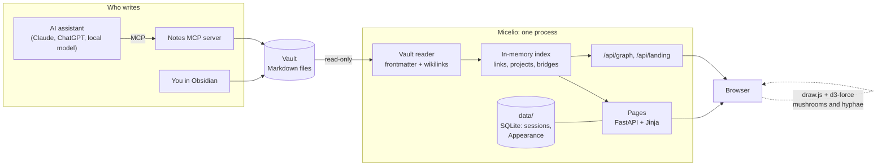

# Micelio

**Your Markdown notes as a living network of ideas.** Micelio reads a folder of notes (an
Obsidian vault, or any folder of `.md` files) and shows it as projects, links and graphs on a
small self-hosted website. It is read-only: your notes stay plain files that you, your editor
or an AI assistant write.

*Micelio* is Spanish for mycelium, the web of threads that grows under a forest; say
"mee-SEH-lyo".

[](https://github.com/0xpietri/micelio/actions/workflows/ci.yml)
[](https://pypi.org/project/micelio/)
[](LICENSE)


## Why

Notes written over months, by hand or by an assistant over [MCP](https://modelcontextprotocol.io),
pile up into a web of ideas that a file list cannot show. Micelio makes that web visible:

- **Projects** grow above ground like mushrooms; the **notes** they link to spread below as
  mycelium, and notes shared by projects of different categories become visible **bridges**.
- **Graphs** for the whole vault, for each project and around each note.
- **Health**: broken links (shown as ghost nodes), unknown frontmatter values and orphans.
- **Sharing**: mark a note `public: true` and anonymous visitors can read it; everything else
  needs a sign-in.
- **Any assistant**: Micelio does not care who wrote the notes. Claude, ChatGPT, a local
  model or you in Obsidian all work.

## Quick start

**Try it** on the bundled sample vault, with Docker:

```sh
git clone https://github.com/0xpietri/micelio
cd micelio
docker compose -f compose.example.yml up        # http://localhost:8765
```

**On your own computer**, with [uv](https://docs.astral.sh/uv/) (Linux, macOS or Windows),
no Docker needed:

```sh
uvx micelio serve --vault ~/Obsidian     # http://127.0.0.1:8765
```

(or `pipx install micelio`, then `micelio serve --vault ~/Obsidian`). On
`127.0.0.1` sign-in is off until you set it up; nobody else can reach it.

**On a server**, run the image `ghcr.io/0xpietri/micelio` (amd64 and arm64, so a Raspberry
Pi works too) with the vault mounted read-only:

```sh
docker run -d --name micelio --read-only --tmpfs /tmp -p 127.0.0.1:8765:8765 \
  -v ~/Obsidian:/vault:ro -v micelio-data:/data --env-file .env \
  ghcr.io/0xpietri/micelio:0.1
```

`.env` holds the sign-in secrets (see [Signing in](#signing-in)); put a reverse proxy with
TLS (Caddy, Nginx, Traefik) in front. [`compose.example.yml`](compose.example.yml) shows the
same as a Compose file, and the [server guide](docs/guides/self-hosting-server.md) walks
through a whole setup with a notes MCP server.

To work on Micelio itself, see [CONTRIBUTING.md](CONTRIBUTING.md): `uv sync`, then
`uv run micelio serve --vault examples/vault`.

## How it works



- The vault is the only source of truth. Micelio re-reads files when they change and keeps
  the index in memory; delete its data folder and nothing is lost.
- Its own state (sign-in sessions, the Appearance page's choices, an uploaded background)
  lives in a small SQLite file in the data folder, never in the vault.
- Pages are rendered on the server; the landing and the graphs are plain JavaScript modules
  over JSON, with vendored libraries and no build step.
- Anonymous visitors get a filtered view built from `public: true` notes only.

## Talking to your notes

Micelio shows notes; an MCP server writes them when you talk to an assistant, from a desktop
app or from your phone in voice mode. The [self-hosting guides](docs/guides/README.md) set up
both, either [on your own computer](docs/guides/self-hosting-computer.md) (Linux, macOS,
Windows) or [on a server](docs/guides/self-hosting-server.md).

## How a vault is read

```
vault/
  projects/   one note per project, with a category; it links to its notes
  notes/      one idea per note
  journal/    dated entries
  sources/    books, papers, links
```

Each note may start with a frontmatter block:

```yaml
---
type: project            # project | note | journal | source (otherwise taken from the folder)
category: science        # projects only; one of the categories in micelio.toml
status: active           # draft | active | paused | closed
tags: [gravity, astrology]
created: 2026-11-09
public: false            # true lets anonymous visitors read it
aliases: [Planets at birth]
---
```

Links use Obsidian's `[[wikilink]]` syntax, including `[[Note#Heading|label]]`, aliases and
paths. A note belongs to a project when the project links to it. Hidden folders (`.obsidian`,
`.trash`) and Syncthing conflict copies are ignored. Nothing in the frontmatter is required;
odd values are reported by `micelio check`, never fatal.

## Interface languages

The interface ships in English and Spanish (`language = "es"` in `micelio.toml`); your notes
are always shown as written. Adding a language takes one file, see
[CONTRIBUTING.md](CONTRIBUTING.md#adding-a-language).

## Configuration

Copy [`micelio.example.toml`](micelio.example.toml) to `micelio.toml` and point
`--config` (or `MICELIO_CONFIG`) at it. It holds the site title, the owner's name, the vault
folders and the categories, each with a mushroom species for the landing page.
Secrets never go in this file; see [`.env.example`](.env.example).

## The landing and its look

The home page draws your vault as a forest: each project is a mushroom above the soil (its
species comes from the category, its size from its notes, its shape from its status), notes
are clouds of spores in the mycelium below, links are threads, sources are crystals and the
latest journal notes float as golden spores. Hover for titles, click to open.

Signed in, **Appearance** (`/appearance`) changes how it looks: four palettes (Psychedelic,
Tokyo Night, Catppuccin Mocha, Rosé Pine), your own background image, where the soil starts,
and the title and tagline. It also builds a prompt you can paste into any image generator to
paint a background that fits. These choices are saved in the data folder, never in your notes;
`[landing]` in the config sets the defaults.

## Signing in

One person signs in, with a password and a code from an authenticator app (any TOTP app:
Aegis, 2FAS, Google Authenticator, 1Password…). Generate the three secrets once and put them
in your environment:

```sh
micelio user set-password    # prints MICELIO_PASSWORD_HASH
micelio user totp            # shows a QR code, prints MICELIO_TOTP_SECRET
micelio user session-key     # prints MICELIO_SESSION_KEY
```

- Sessions last 12 hours and are stored server-side, so signing out really ends them.
  `micelio user sign-out-all` ends every session.
- Five failed attempts from one address lock it out for 15 minutes.
- On your own computer, `micelio serve` listens on `127.0.0.1` only; with no secrets set,
  sign-in is simply off there. On any other address, Micelio refuses to start without them.
- Already behind Cloudflare Access, Authelia or another gateway? Set `auth.mode = "none"` and
  Micelio trusts whoever reaches it. Only do this when the gateway really guards every path.

## Security

- Micelio never writes to the vault; mount it read-only. The image runs as a non-root user
  with a read-only root filesystem and writes only to `/data`.
- Anonymous visitors see notes marked `public: true` and nothing else: no private titles,
  links, counts or ghost nodes, and a private note's URL answers 404.
- Sign-in is a password plus a TOTP code, with server-side sessions and a lockout. Micelio
  refuses to listen on a public address without its secrets, unless you say a gateway
  handles sign-in (`auth.mode = "none"`).
- Every response carries a strict Content Security Policy (no inline code, no framing), and
  note bodies are sanitized.
- Secrets live in the environment, never in `micelio.toml`. Report problems privately, see
  [SECURITY.md](SECURITY.md).

## Roadmap

- **v0.1** (this release): the landing, the graphs, the reading pages, sign-in, public notes,
  the Appearance page, English and Spanish, Docker image and PyPI package.
- **v0.2**: a static export of the public notes, to share them without a server
  (GitHub Pages, Cloudflare Pages, Netlify or a zip).
- **v0.3**: an Obsidian plugin with the landing and the graph inside Obsidian.

The full specification is in [`docs/spec`](docs/spec/MICELIO_SPEC_v0.1.md); what changed in
each version is in the [CHANGELOG](CHANGELOG.md).

## Contributing

See [CONTRIBUTING.md](CONTRIBUTING.md). Security reports: [SECURITY.md](SECURITY.md).

## License

[MIT](LICENSE) © 2026 Marcos Pietri
